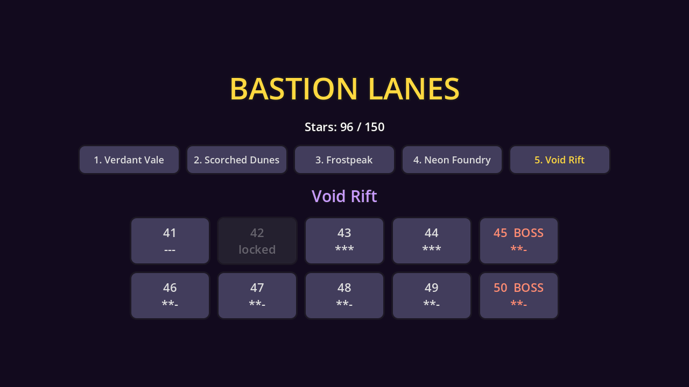
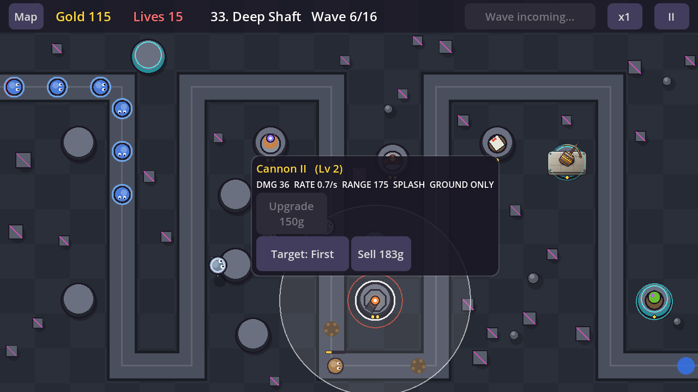

# Bastion Lanes (working title)

A 2D arcade tower defense game for Android / Google Play, built with **Godot 4.4** (GDScript).

- Design: [docs/GDD.md](docs/GDD.md)
- Tower art prompts: [docs/art/tower-prompts.md](docs/art/tower-prompts.md)
- Game project: [`game/`](game/) (open `game/project.godot` in Godot 4.4+)

## Current state: full content build (step 3 of 4)

- **Campaign:** 50 levels in 5 worlds (Verdant Vale, Scorched Dunes, Frostpeak, Neon Foundry, Void Rift), world map with unlocks and saved stars.
- **Layouts:** single lanes, long loops, forks, merging spawns, parallel lanes (2 and 3), crossing lanes, four-gate crossings, and air routes.
- **World mechanics:** sandstorms shrink tower range (World 2), ice patches speed enemies up (World 3), power-node pads give +25% damage (World 4), rifts teleport enemies between lanes (World 5). Worlds 2 and 3 also bring fire and frost resistant enemies.
- **10 towers**, each with 5 levels and a branch choice at level 4: Bolt, Cannon, Frost Spire, Tesla Coil, Railgun, Inferno, Skyhunter, Venom Spore, Amplifier, Prism Laser. Towers unlock as the campaign goes on (see `unlock` in `towers.json`).
- **13 enemies:** armored, shielded, flying, healers, splitters, regenerators, stealth, burrowers and elite Wardens.
- **10 bosses** on every level ending in 5 or 0, each testing a different tactic (hardening shell, armor shedding, burrowing, summoning, tower freezing, splitting titan, EMP, flying carrier, lane teleporting, and a 3-phase final boss).
- **Balance:** a heuristic bot plays every level headless and `tools/balance.py` tunes each level's enemy HP until the bot wins while losing some lives.
- **Art:** towers use sprites from `art/` when available (Bolt so far, via `game/tools/sync_art.sh`), otherwise code-drawn placeholders.

Not built yet (from the GDD): tower loadout limit, research tree, hero abilities, conveyor belts, Veteran and Endless modes.

## Where things live

| Path | What |
|---|---|
| `game/data/towers.json` | All tower stats per level/branch. Balance here, no code changes needed |
| `game/data/enemies.json` | Enemy stats |
| `game/data/levels/*.json` | Generated levels: paths, air paths, pads, modifiers and waves |
| `game/tools/gen_levels.py` | Level generator (layouts, pads, waves, difficulty curve) |
| `game/tools/balance.py` | Bot playtests every level and tunes difficulty (`tools/tuning.json`) |
| `game/scripts/game.gd` | Level runner: waves, economy, building, input, map drawing |
| `game/scripts/tower.gd`, `enemy.gd`, `projectile.gd`, `fx.gd` | Gameplay objects |
| `game/scripts/hud.gd`, `menu.gd` | In-level UI and world map |
| `game/scripts/bot.gd` | Headless test player |

## Running

Open `game/project.godot` in Godot 4.4 and press Play.

Headless playtest of one level (prints a JSON result):

```
cd game && godot --headless --fixed-fps 60 res://scenes/main.tscn -- --level=level_07 --autotest=auto
```

Regenerate levels and rebalance everything:

```
cd game && python3 tools/gen_levels.py && GODOT=/path/to/godot python3 tools/balance.py 8
```

Note for Android export (step 4): JSON files are not resources, so the export preset must include `*.json` in "Filters to export non-resource files".




## Download

The latest debug build is [apk/bastion-lanes-debug.apk](apk/bastion-lanes-debug.apk). Uninstall any earlier build first (each build machine signs with a different debug key).

## Building the Android APK

`game/export_presets.cfg` has an "Android" preset (arm64 + armv7, landscape, includes `*.json`). With Godot 4.4.1 export templates installed and the Android SDK/keystore set in Editor Settings:

```
cd game && godot --headless --export-debug "Android" ../build/bastion-lanes-debug.apk
```
